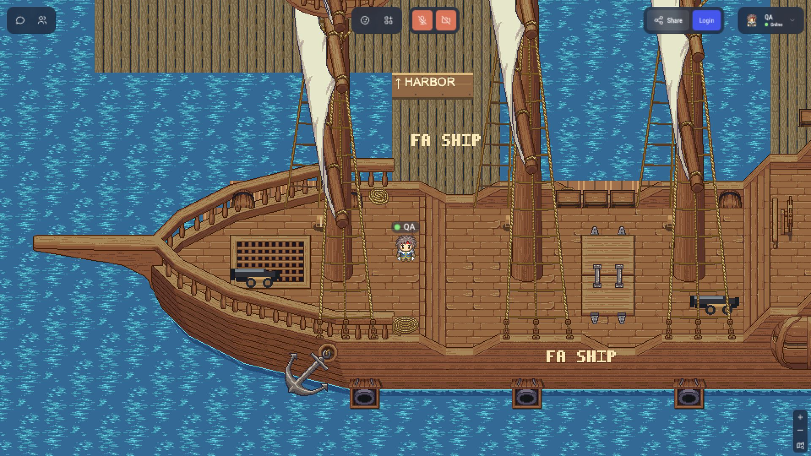

# VarCamp Myanmar — zodiac WorkAdventure world

Thirty-three connected, editable maps with twelve separate zodiac speaker buildings, a central welcome plaza, halls, parks, arcade lounges, two mazes, beaches and the sailing **FA SHIP**. Roads lead to signed gates outside the speaker plaza. New arrivals start at the central welcome point.

[Enter the live demo](https://varcamp.3-1-133-135.sslip.io/~/varcamp-demo/maps/overworld.wam) · [Published map files](https://htooayelwinict.github.io/varcamp-map/) · [Download the built bundle](https://github.com/htooayelwinict/varcamp-map/releases/latest)

The GitHub Pages **WorkAdventure custom map URL** is:

```text
https://htooayelwinict.github.io/varcamp-map/maps/overworld.tmj
```

This URL is a map asset, opened by a WorkAdventure client. GitHub Pages hosts the maps and runtime assets; WorkAdventure supplies the multiplayer service. The devbox demo is separate.



## Edit or build

Use Node **26.11.1**, npm and Apple Python **3.9.6** for the legacy operational fixtures. Install dependencies and validate the authored maps:

```sh
npm ci
npm run maps:validate
npm run art:check
npm run maps:build
npm run buildmap
```

`dist/` contains the ready-to-host world: 33 TMJ maps, 33 WAMs, runtime scripts, the independent `bots/lyra.js` module, sponsor artwork, source atlases and credits. It omits private configuration and development previews. Copy its full contents to a static HTTPS host; keep the relative paths intact. For an existing edited WorkAdventure world, follow the guarded publication procedure rather than overwriting live WAM state.

Open `maps/*.tmj` in Tiled. Normal `maps:build` preserves native edits and refreshes `maps/preview/`. Hand-composed source layouts are in `world/layouts/`; editable artwork and full source credits are retained in `art/` and `assets/`. The map files and assets match the developed world byte for byte; [the snapshot manifest](publication/source-manifest.json) records them.

Read [map editing](docs/operating/map-editing.md), [the venue guide](docs/operating/venue-guide.md), [sponsor replacement](docs/operating/sponsors.md), and [GitHub publishing and test prerequisites](docs/operating/github-publication.md). On a fresh clone, the ignored native-edit guard manifest is absent: use `npm run maps:author -- --initialize` only when intentionally reauthoring from layouts. Do not use that command to overwrite later Tiled edits.

## Verification and publishing

The local complete suite passed **754 tests plus 7 Python checks** before publication, including the central default-spawn regression and all 25 existing named entry selections. The full suite also uses Docker CLI 29.8.0 and Compose 5.5.1 to parse configuration fixtures; it does not require a Docker engine. Run it with:

```sh
npm run buildmap
npm test -- --maxWorkers=1 --testTimeout=30000
```

Full verification uses macOS ARM64 and official Tiled 1.12.2 at `.tools/tiled-1.12.2/Tiled.app/Contents/MacOS/tmxrasterizer`. GitHub installs that pinned, checksum-verified tool and runs all tests. An independent Linux job verifies the original 303 source receipts, their exact reviewed replacements, the 49 separately reviewed extension hashes and all 33 native map pairs without regenerating artwork. The snapshot’s original 303 paths and hashes remain unchanged; `extensionInventory` in the manifest records added source files and the changed root build configuration. The entrance also includes a [stationary native Roadster animation](docs/operating/roadster.md), with source/crop receipts and unchanged walking routes. The exact upstream compatibility fixtures and required regression baselines are included. Local operational archives and private deployment history are excluded.

The reviewed Lyra module targets [the stable script URL](https://htooayelwinict.github.io/varcamp-map/bots/lyra.js). Before activating any release, verify that the complete canonical CI run succeeded, the Pages deployment completed, and the exact HTTPS module bytes match the reviewed package. Then test the real shared behavior with two independent visitors in the dedicated bot session. Use `?v=<sha256>` for the verified module. A local build alone is not live acceptance. See [Scripted Lyra](docs/operating/scripted-lyra.md) for the `default.run` contract and activation checks, and the [isolated devbox launcher](ops/bots/README.md) for private start/stop/status commands.

Pushing `main` runs strict artwork and build checks on macOS ARM64, independently checks the frozen source inventory on Linux, and deploys the ready-to-host maps through GitHub Pages only when both jobs pass. Linux artwork regeneration currently changes decoded flight-atlas pixels and is unsupported; use the canonical macOS authoring environment. Publishing preserves the existing artwork bytes. This publishes map assets; it does not alter the devbox or WorkAdventure server. The original public draft files `varcamp.tmj`, `tileset.png` and `build_map.py` remain for reference; the current world starts at `maps/overworld.tmj`.

Sponsor marks are fictional demo placeholders for the team to replace. The optional server-side OpenRouter key applies only to the legacy NPC chat server, which is currently offline. Scripted Lyra uses authored replies and needs no OpenRouter key. Never put keys in map files or client scripts.

## Credits and licenses

This is a WorkAdventure map project, not a standalone asset pack. Starter-derived code retains its [MIT notice](LICENSE). Artwork and compatibility fixtures have separate licenses: see [the source manifest](art/sources.json), each asset folder’s LICENSE/ATTRIBUTION/CREDITS files, and the published [credits](https://htooayelwinict.github.io/varcamp-map/credits/index.html). The native ship, dock, water and containers retain their LPC author credits. Paid tileset preview images are not redistributed as production artwork.
