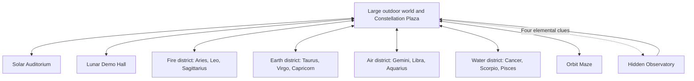
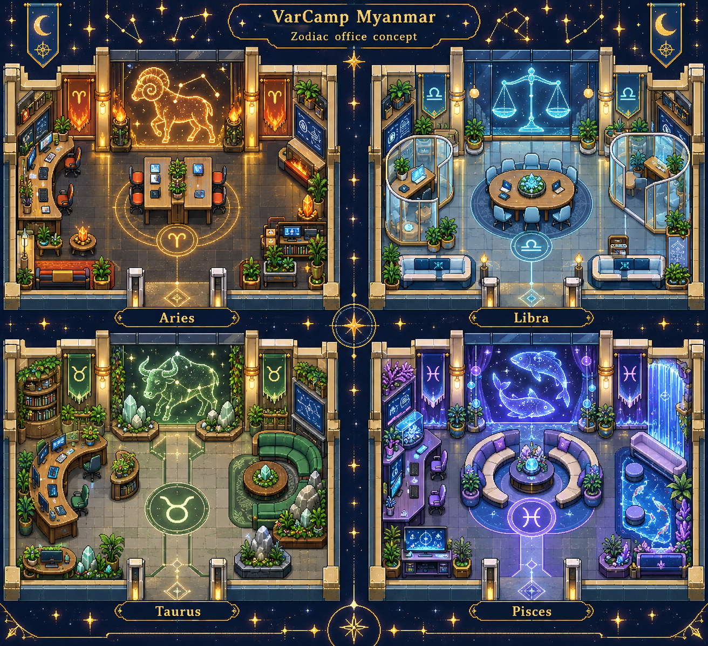

# VarCamp Myanmar Cosmic World Design Draft

VarCamp Myanmar will be an explorable cosmic campus for a technology knowledge sharing event, designed for 30–100 simultaneous attendees. A large outdoor world connects to presentation halls, all twelve zodiac rooms, a maze, and a hidden observatory. Visitors can attend sessions, meet people in the park, and complete optional personal side quests between talks.

The selected style is a cosmic night campus with richly decorated technology offices and zodiac magic. Combine the collaborative spaces associated with Google offices and the clean material finish associated with Apple offices: glass partitions, warm wood, carefully arranged desks and lounges, digital screens, and integrated lighting. Navy and indigo architecture, warm gold pathways, readable constellation signs, luminous plants, and magical zodiac centrepieces connect the world visually. Exploration must feel rewarding while the event programme remains easy to reach.

## Approved direction and expanded scope

The user approved Tiled map creation and a separate WorkAdventure deployment on the existing SSH host `devbox`. They selected the twelve Western zodiac signs and requested a bigger world with entrances, exits, hidden worlds, mazes, and audience side quests. The design below incorporates those additions.

The proposed initial release includes nine connected maps and three complete quest loops. Main event spaces remain open regardless of quest progress. Each separate map has a visible exit and a journal action that returns the visitor to Constellation Plaza. The user approved this revised written design on 2026-10-11.

The user wants the agent to find reusable tilesets and complete the map assembly and decoration, including manual editing where useful. Organiser editing is optional, not a prerequisite for delivery. Editable Tiled sources remain part of the handover. For initial hosting, use the box's Elastic IP with IP-derived HTTPS hostnames; purchasing a domain is not required.

After seeing the actual Aries and Libra tile samples, the user refined the visual direction: speaker rooms must have a clean, professional presentation layout. Rich magical decoration remains welcome in hallways and other rooms. This refinement applies to all twelve zodiac session rooms and the presentation floors of both main halls.

## World layout

An overworld is the outdoor map visitors can freely walk around. Building entrances load smaller interior maps so the world can be large without making every visitor load every room at once. All nine maps use a consistent visual vocabulary and belong to the same WorkAdventure world.

| Map file | Size in 32 pixel tiles | Contents |
| --- | --- | --- |
| `overworld.tmj` | 256 by 192 | Constellation Plaza, welcome desk, directory, district gates, Star Garden, Orbit Playground, Moon Cafe, rivers, bridges, woods, hidden paths, and telescope landmark |
| `solar-hall.tmj` | 80 by 64 | Keynote auditorium, podium, audience floor, resource boards, and a separate speaker preparation room |
| `lunar-hall.tmj` | 72 by 56 | Demo theatre, presentation podium, audience floor, collaboration tables, and a speaker preparation room |
| `fire-district.tmj` | 96 by 64 | Aries, Leo, and Sagittarius rooms; gold and amber star motifs |
| `earth-district.tmj` | 96 by 64 | Taurus, Virgo, and Capricorn rooms; mineral gardens and jade accents |
| `air-district.tmj` | 96 by 64 | Gemini, Libra, and Aquarius rooms; cyan accents and sky bridges |
| `water-district.tmj` | 96 by 64 | Cancer, Scorpio, and Pisces rooms; violet accents and luminous pools |
| `orbit-maze.tmj` | 80 by 80 | Walkable constellation maze, three landmarks, optional hints, and a finish shrine |
| `hidden-observatory.tmj` | 64 by 48 | Secret star chamber, constellation display, discovery reward, and return portal |

The map sizes are design targets and may shrink during visual tuning if they produce long empty walks. The overworld must retain the sense of a large landscape through varied paths, landmarks, and optional discoveries.

The plaza sits near the centre. Fire and Air occupy the northwest and northeast, with Earth and Water southwest and southeast. The two main halls sit directly north of the plaza. Star Garden is to the west, Orbit Playground to the east, and Moon Cafe near the southern arrival route. A woodland route leads north to the maze; an unusual telescope in the garden gives the first clue to the observatory.

Main avenues are at least eight tiles wide, secondary paths four tiles wide, and maze corridors at least three tiles wide. Fences, rivers, buildings, and map borders have consistent collision rules. Bridges and doorways have clear walking space. Decorations never obscure a sign or an entrance.

## Arrivals and navigation

Visitors start in a broad welcome zone within the plaza, away from doors and conversation tables. The welcome board explains movement, entering buildings, the quest journal, and returning to the plaza. It also provides direct actions for the two halls and four district entrances. Visitors who want to explore can use the roads; visitors joining a session can use the directory.

Every building has a named entry point. Returning through its exit places the visitor outside the corresponding overworld doorway. Entry tiles never overlap exit triggers, which prevents immediate bouncing between maps. The welcome board and journal display the venue's plaza URL so a visitor can save it and reopen the venue if a destination fails to load. A transition is not assumed to provide an API error callback or preserve the source room.

The journal contains **Return to Plaza**, **Go to Solar Hall**, and **Go to Lunar Hall** actions, registered again on every map load before quest-state loading. These remain available in the maze and hidden observatory even when a quest is unfinished or a progress save fails. The maze also has **Restart Maze**, which returns the visitor to its entrance without removing completed badges. Static doors and physical return exits continue to function if quest scripts fail. Quest errors never block admission to a hall.

Entries and exits use supported named spawn layers and map transitions. The final destination URLs are derived from the deployed world rather than hardcoded to WorkAdventure's public testing instance. [Entries and exits documentation](https://docs.workadventu.re/map-building/tiled-editor/entry-exit/)

## Event rooms and conversations

Solar and Lunar each have a unique native podium linked only to their own audience area. Zodiac rooms have individually named native meeting areas. Each district contains three room entrances and a shared vestibule, which gives visitors a place to read signs and collect quest stamps without entering a live meeting. Speaker preparation rooms use separate meeting names so their audio cannot reach audiences.

Visitors enter meeting rooms with camera and microphone off by default. Audience areas support raised hands and the speaker giving someone the floor. The park and cafe include spaced conversation pockets; arrival routes and signboards avoid concentrated conversation zones. The maze and observatory default to quiet exploration, with a clearly marked social alcove outside the maze.

Podium access for presenters and staff is enforced using the deployment's supported identity and role configuration. A decorative backstage wall does not count as access control. Public visitors can enter audience and discussion spaces; they cannot edit the map or operate staff controls. Role setup is part of deployment configuration and must be verified with separate staff and attendee identities.

The initial programme board lists venue destinations and displays **Ask the help desk for the current programme** until the organiser supplies an agenda. Speaker names, event dates, external meeting links, and schedules are not invented.

Native stages and meetings are configured through WorkAdventure's map editor and saved with their WAM metadata. [Podium and audience documentation](https://docs.workadventu.re/map-building/inline-editor/area-editor/broadcast/), [meeting room settings](https://docs.workadventu.re/map-building/inline-editor/area-editor/meetingRoom/)

## Decoration standard for every space

All twelve zodiac session rooms must feel designed, furnished, and presentation focused. Each has an identifiable front stage or presentation wall, a large modern screen, a lectern or speaker position, orderly audience seating oriented toward the front, and clear sightlines. Keep the central aisle at least two tiles wide and the front presentation floor clear of desks, planters, coffee tables, and freestanding magical props. Use warm wood, glass, restrained integrated lighting, and a small number of perimeter plants. Shared architecture creates a coherent campus, but each room retains a distinct restrained zodiac backdrop and layout; changing only its sign is insufficient.

The same standard applies to every existing space, including shared vestibules, corridors, speaker preparation rooms, social alcoves, and the moon grotto. Give each auxiliary space a deliberate combination of decorated wall surfaces, appropriate furniture or seating, integrated lighting, and zodiac details. Inspect these spaces individually so no bare passage or unfinished backstage area is hidden by a polished map overview.

Each zodiac room includes a readable entrance name and glyph, a bespoke constellation or zodiac feature integrated into its front wall, a modern presentation screen, seating, clean wall panels or glass partitions, subtle perimeter lighting, and clear circulation. Collaboration tables, lounge seating, elaborate sculptures, and playful magic belong in adjoining district alcoves, foyers, or other social spaces instead of crowding the talk floor. Furniture remains at a consistent pixel scale relative to avatars. Rich decoration means deliberate finish and detail, not a high object count.

| Room | Magical centrepiece | Furniture and environment character |
| --- | --- | --- |
| Aries | Ram constellation and slim forge motif in the stage wall | Charcoal presentation floor, angular seating blocks, amber wall channels; coding desks in the adjoining alcove |
| Taurus | Bull constellation with restrained jade crystal relief | Warm wood seats, soft green wall accents; living garden and lounge in the foyer |
| Gemini | Twin holographic stars beside one primary screen | Paired audience blocks and mirrored glass wall details; paired workstations outside the talk floor |
| Cancer | Moonlit crab emblem with a shallow pool motif in the backdrop | Pearl wall panels and gently curved audience seating; moon pool and crescent lounge in the adjacent social space |
| Leo | Solar lion relief above the stage | Gold stage backdrop, orderly modern seating, warm light; speaker lounge behind the presentation area |
| Virgo | Fine constellation and geometric crystal wall pattern | Precisely aligned audience seats, restrained botanical edges; research desks in the adjoining alcove |
| Libra | Celestial balance integrated into the front wall | Symmetrical seating blocks, cyan light strips, clean glass sides; circular table and pods in the foyer |
| Scorpio | Violet scorpion constellation in an illuminated wall feature | Dark glass stage trim and simple purple accents; brainstorming booths outside the session room |
| Sagittarius | Star bow and a restrained projected comet line | Open lecture seating, gold directional details; workshop tables and telescope in adjoining spaces |
| Capricorn | Mountain and sea-goat wall relief | Structured seating tiers, walnut stage finish, narrow mineral accents; terraced lounge outside the talk floor |
| Aquarius | Vessel and flowing light motif in the stage wall | Cyan screen surrounds, gently curved glass side panels; collaboration benches in the social alcove |
| Pisces | Two orbiting fish constellations above the display | Calm violet wall inlay, flowing but uncluttered aisles; crescent lounge and luminous water feature in the foyer |

Both halls use the same clean presentation principle: one focal stage, orderly audience seating, side screens only where useful, subtle acoustic-looking wall panels, clear lit aisles, and coherent floor materials. Speaker preparation rooms are comfortable and uncluttered; foyers and corridors can carry richer zodiac decoration. The welcome desk has a glass and wood counter with an illuminated star canopy. Moon Cafe has furnished booths, a counter, warm fixtures, and cosmic menu boards. Star Garden contains planted paths, sculptural benches, fountains, and zodiac sculptures. Orbit Playground uses light rings, stepping-stone patterns, and interactive clue objects. The maze includes decorated walls and distinct landmarks; the observatory has a telescope, star display, seating, and an elaborate discovery shrine.

Magic is integrated into the technology: holograms form constellations, rune inlays mark door thresholds, crystals power decorative screens, and the personal telescope portal appears through a quest interaction. Static art supplies the base atmosphere. Small animations can enrich key features, but decorative effects must not flash, hide exits, obscure text, or force sound and video to play.

The [room concept](../../design-assets/zodiac-office-concept.png) remains a materials and social-space reference using Aries, Libra, Taurus, and Pisces. Its dense office arrangements are superseded for speaker rooms by the user's clean presentation refinement. It is not a playable map or a ready-made tileset. The final map uses WorkAdventure's orthogonal tile layout with appropriately scaled furniture. The [generation prompt](../../design-assets/zodiac-office-concept-prompt.txt) records the earlier preview. During construction, inspect an overview and close-up of each map plus all twelve room interiors against the current furnishing requirements above.

## Audience side quests

Quests are optional, untimed, and individually tracked. Rewards are personal journal stamps and discovery badges. No competition, prizes, payments, leaderboard, or attendance requirement is attached to them. A visitor can stop at any point and attend a session.

| Quest | Actions and completion | Reward |
| --- | --- | --- |
| Zodiac Passport | Activate the twelve sign beacons in district vestibules. Each unique sign counts once; the journal lists discovered and missing signs. Complete at twelve discoveries. | Zodiac Explorer badge |
| Orbit Maze | Enter from the woodland gate, follow the maze to the finish shrine, and activate it. Three recognisable landmarks orient the visitor. Hints are available on request, and a full route hint is available for anyone who wants it. | Maze Navigator badge |
| Hidden Observatory | Collect one elemental sigil from each district's shared entrance area. Return to the garden telescope and activate it after all four are collected. Enter the observatory with those four saved sigils to complete the discovery. | Stargazer badge |

The four sigils are Fire, Earth, Air, and Water. A plaque at the telescope says **Four districts hold four lights. Bring them here to reveal the stars.** A district entrance gives a plain hint toward its sigil. The journal reports how many have been found without revealing the final chamber in advance.

The maze has a fixed, tested route rather than a randomly changing layout. Landmarks are a crescent fountain, a comet statue, and a ring of stars. The finish shrine is reachable without teleporting or passing through a collision tile. Hint use does not reduce the reward.

The observatory gate is personal: one person's discovery does not open or close it for everyone. Returning from it is always possible. This is a playful discovery gate, not a security boundary; a copied destination URL must not expose private event data. Direct entry without all four saved sigils allows exploration but does not award the Stargazer badge; the journal explains how to find the four sigils.

Quest interactions use an explicit action near a beacon or clue, not an unsolicited popup when someone walks past. Decorative hidden paths and a moon grotto in the overworld add exploration beyond the three quests.

## Quest progress and failure behaviour

Custom map scripts store private, persistent player progress in WorkAdventure's world scope, after API initialisation. Guest progress is stored in that browser; signed-in progress can be stored by WorkAdventure. Progress must be reread whenever a new map loads. Clearing browser storage or using a different guest browser can reset progress. [Player state documentation](https://docs.workadventu.re/developer/map-scripting/references/api-player/)

Production maps must use the self-hosted map-storage world with `/~/` room URLs. Public `/_/` test URLs treat world-scoped state as room-scoped and therefore do not prove cross-map quest persistence. A hosted rehearsal, if used, must put every map in one registered world. All progress variables use a `varcamp2026` namespace so other maps on the same server do not reuse them. [Player state scope](https://docs.workadventu.re/developer/map-scripting/references/api-player/)

Store each sign and each elemental sigil as a separate boolean variable. Repeated collection is harmless. Maze completion and observatory discovery are separate booleans. The journal derives counts from those flags, rather than trusting a stored counter. Values are checked at runtime; invalid values are treated as undiscovered. Do not collect email addresses or publish player progress to other visitors.

A failed save keeps the interaction retryable and displays **Progress could not be saved. Try again.** Await a successful quest-state write before a quest-triggered map transition. A script failure leaves physical navigation and event access available. The first release supports one active quest tab per visitor; live synchronisation between different maps in multiple tabs is outside scope.

## Map construction and assets

Start from the official WorkAdventure map starter kit and retain its compatibility settings. Maps are orthogonal JSON TMJ files, with 32 by 32 pixel tiles, embedded tileset definitions, a required `floorLayer` object group, valid spawns, and boolean collision properties on blocking tiles. Use the checked-out starter kit's actual package scripts for building and previewing. [Tiled guide](https://docs.workadventu.re/map-building/tiled-editor/), [map rules](https://docs.workadventu.re/map-building/tiled-editor/wa-maps/), [starter kit](https://github.com/workadventure/map-starter-kit)

Map data, quest logic, navigation, and presentation UI remain separate so scenery can change without rewriting quest rules. Art assets use a consistent pixel scale. Custom zodiac emblems and constellations share a common style. Reused assets retain author and licence credits; no premium or unlicensed asset purchase is part of this design.

Text and destinations must remain readable against the night palette. Sign names accompany every zodiac symbol. Motion is decorative and restrained; avoid flashing lights and forced music. Ambient sound, if added, is off by default and can be enabled by the visitor.

Editable TMJ sources, WAM metadata, tilesets, scripts, licences, a buildable project, and operating instructions are deliverables. A rendered image alone is not an interactive WorkAdventure map.

## Hosting and delivery boundaries

The current hosted account is capped at ten simultaneous users. Hosting map assets on GitHub Pages or AWS does not increase that hosted cap. The selected event path is an independently operated WorkAdventure instance on `devbox`, with LiveKit for larger conversations and TURN for networks that need relayed media. [Hosted pricing](https://workadventu.re/pricing/), [production hosting guide](https://github.com/workadventure/workadventure/blob/master/docs/others/self-hosting/install.md)

The read-only server check found ARM64 Linux, eight logical CPUs, approximately 32 GB RAM, Docker, and about 81 GB available disk space. Existing applications run on the same host. Deploy the venue as its own Compose project, with separate volumes, a dedicated domain, and compatible ingress routing. Do not stop, replace, or expose existing applications as part of this event setup. Domain selection and available network ports are resolved during deployment preparation, before any public launch.

Deployment preflight must pin a WorkAdventure release and its matching Compose configuration, verify ARM64 availability for every selected container image, compatibility with the host's existing ingress, media DNS and UDP/TCP reachability, a functioning TURN relay, and a supported identity configuration that permits public attendance while issuing staff roles. Name the actual identity provider and presenter-role mechanism in the deployment plan before promising enforced podium access; editor access alone does not establish presenter rights. Hardware inspection alone does not verify those conditions. If a preflight fails, resolve that component before public launch and report any required domain, identity-provider, or infrastructure choice to the organiser.

Use real HTTPS and the production installation instructions, not development localhost certificates. Map editor access is limited to the organiser's authenticated identity. Public attendance and staff editing rights are configured independently and must pass role tests before enforcement is claimed. Full persistent Matrix chat, recording, and streaming are outside the initial release; the event requires working live conversations, screen sharing, and presentation audio.

The upper attendance design target is 100 connected people. The server's resource count does not establish capacity for 100 simultaneous camera streams. Rehearse at 30, 60, and 100 connected people for at least twenty minutes each, with movement, both halls presenting, and the organiser's expected camera and workshop mix. At the chosen launch attendance, require no server restart or unresolved room-load failure; all rehearsal participants must be able to hear the appropriate presenter and regain audio after changing maps. A rehearsal below 100 verifies only that lower attendance. The camera mix is recorded with the result so capacity is not extrapolated to a heavier video workload. AWS hosting and bandwidth remain operating costs.

Before a group rehearsal, test a midrange laptop and one phone under a 10 Mbps, 150 ms latency connection. Target the first walkable overworld within fifteen seconds after the avatar setup is complete, subsequent room loading within eight seconds, and no sustained movement freezes longer than one second during a two-minute walking route. Record browser, device, and connection conditions. These are acceptance targets to measure, not results already achieved.

## Acceptance criteria

1. All nine maps open in Tiled and load in WorkAdventure without missing assets or script errors.
2. Every default spawn and named entry lies on walkable tiles and cannot immediately retrigger an exit. Every portal has a working return destination.
3. All twelve zodiac rooms, both halls, the park, playground, cafe, maze, and hidden observatory are reachable as designed. Ordinary event spaces remain reachable with zero quest progress.
4. The overworld has distinct landmarks and optional paths; direct directory actions reach event destinations without a long walk.
5. Collision validation proves a path from each spawn to its public exits and quest landmarks. The maze finish is reachable, and its return action works at every point.
6. The three quest loops complete independently for two visitors. Repeated beacons do not increase counts; one visitor cannot change the other's quest state.
7. Quest progress survives map transitions and refreshes within the production world. Invalid state and save failures do not block event navigation.
8. Two real browser sessions verify movement, proximity conversations, zodiac meetings, hall audio, screen sharing, and raised-hand Q&A. Four sessions then test two concurrent presenters with one listener in each hall, proving correct reception and absence of presentation audio from the other hall.
9. Staff and attendee identities verify editor and podium permissions. Guests can explore and complete quests without being granted editing rights.
10. The event passes the specified device and network checks and the staged attendance rehearsal before its public invitation is used. The operating guide states the attendance and camera workload actually verified.
11. An overview and individual close-ups verify complete decoration of every map, all twelve zodiac rooms, and each shared or auxiliary space, including vestibules, corridors, speaker preparation rooms, social alcoves, and the moon grotto. Signs remain readable, paths uncluttered, furniture consistently scaled, and every zodiac room has its unique magical centrepiece.
12. Every zodiac session room and main hall has a clear presentation focus, audience seating facing its primary display/stage, an unobstructed central aisle, and a clear front floor. Zodiac art is integrated into the backdrop or perimeter. Rich collaboration furniture and playful decoration occupy adjoining social spaces rather than the talk floor.

## Scope for later additions

The initial world contains the three quests specified above. Extra secret realms, custom NPC dialogue, a timed escape room, collaborative puzzles, sponsor booths, a leaderboard, and a live agenda integration can be added after the core world works and the organiser specifies their content. The map architecture leaves room for more connected destinations without increasing the initial release's nine-map commitment.
